

  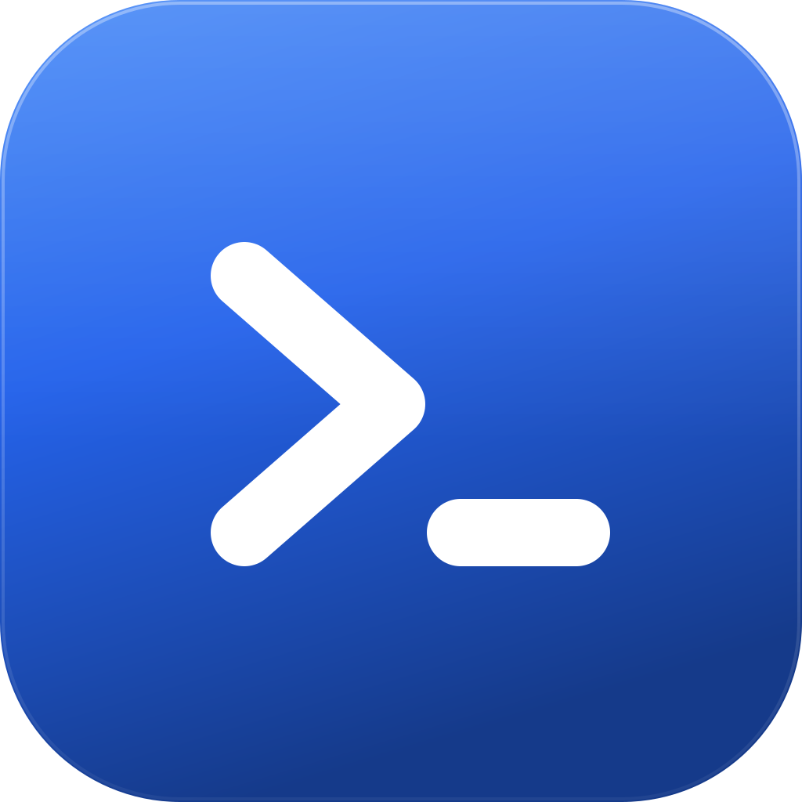
  <h1>CodeShell</h1>
  
<b>一个会自己看服务器、自己动手的 AI 运维工作台。</b>

  

    
    
    
    
  

不只是终端客户端 —— 它把 **AI 助手、智能巡检告警、自动化批量运维** 和终端 / SSH / SFTP / 数据库 / Docker 收在一个窗口里，
让日常运维从「逐个登录、逐条敲命令」变成「**描述目标、审阅执行**」。

> 所有连接与凭据只保存在本机（AES-256-CBC 加密落盘），不上传任何服务器。

---

## 快速看看

### AI 执行：描述目标 → 自主拆解 → 逐条审批

  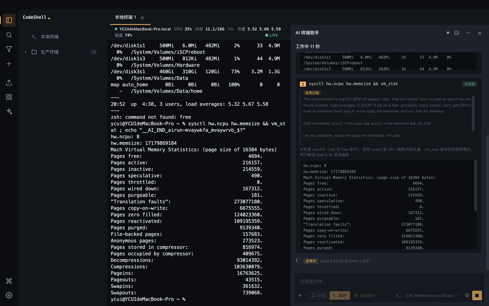

说一句「排查 web-01 磁盘占用过高的问题，并清理可安全删除的过期日志」，
AI 自己决定跑 `df -h` 看分区、用 `du` 定位到 `/var/log`，
再提出删除 14 天前归档日志的命令 —— **每条命令都要你点「允许执行」**，
命令与输出就显示在执行过程里。

 

### AI 结论：不是一堆输出，是一份小结

  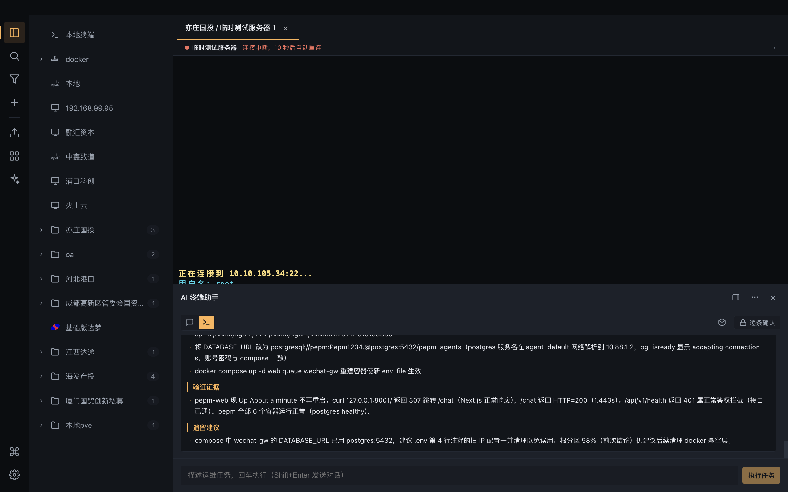

执行完给出**结论 + 判定依据 + 风险提示 + 后续建议**：
哪一步验证了什么、这条命令会不会误删、下一步该改哪个配置，一目了然。

 

### 安全基线检查：一次扫一批机器，出报告

  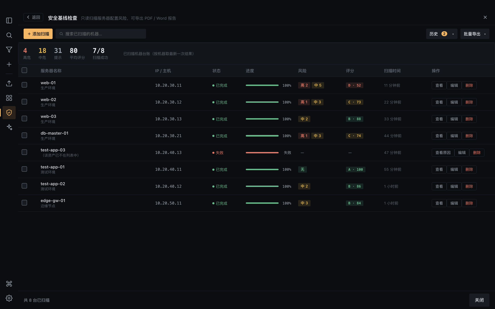

内置 **25 项只读检测**（SSH 加固 / 空口令 / 防火墙 / 口令策略 / SUID / 审计 / 补丁 / 磁盘…），
选一批机器并发扫描，按机器列出台账：名称、地址、状态、**进度**、风险计数、评分与等级。
列表可搜索、分页、编辑备注（标注环境/负责人）、移除条目，
勾选任意几台还能随时重扫。

  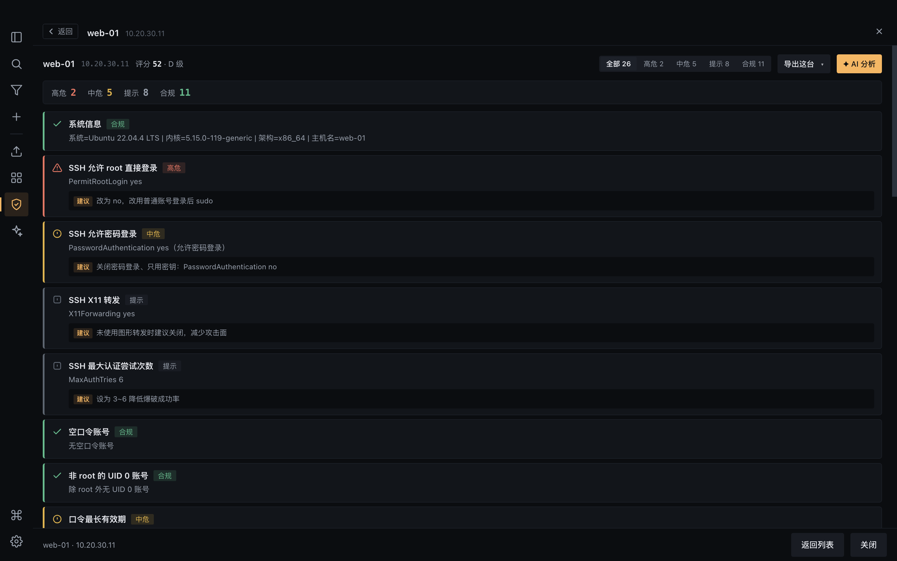

点进任意一台看**逐项明细**：当前值是什么、建议怎么改，可按等级（高危/中危/提示/合规）筛选。
扫描全程只读，不修改目标系统；随时可取消，已完成的机器结果保留。

  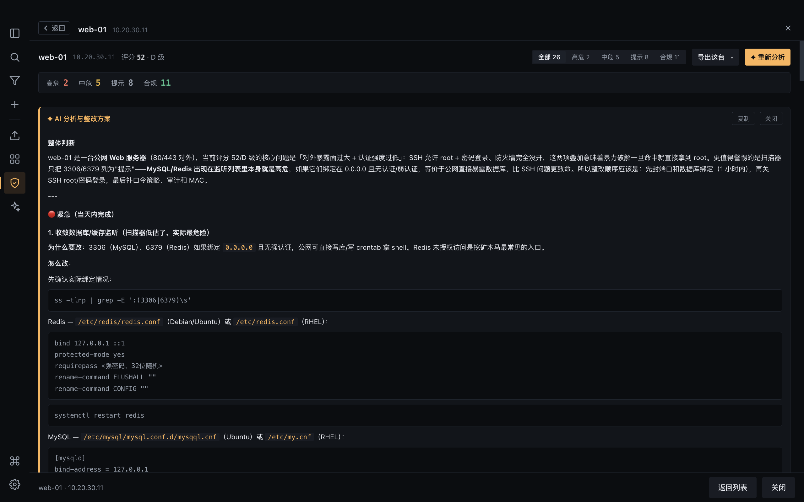

光有检查项还不够 —— 点「**AI 分析**」，把该机的问题清单交给模型，
它会给出风险判断、按「紧急 / 重要 / 可选」分档的整改步骤（附可直接执行的命令）、以及验证方式。
结论可一键复制，也能连同明细导出成 **PDF / Word** 报告，或导出 CSV 汇总。

 

### 其它能力

| | |
|---|---|
| 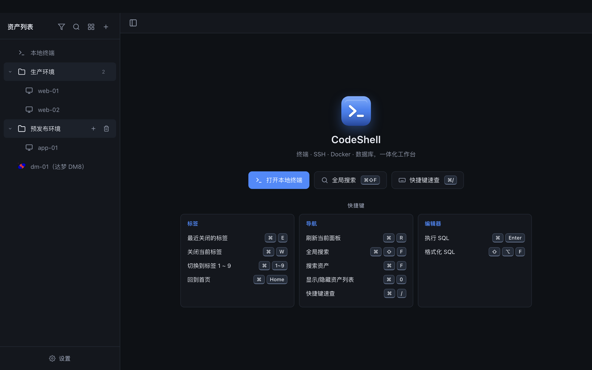 | 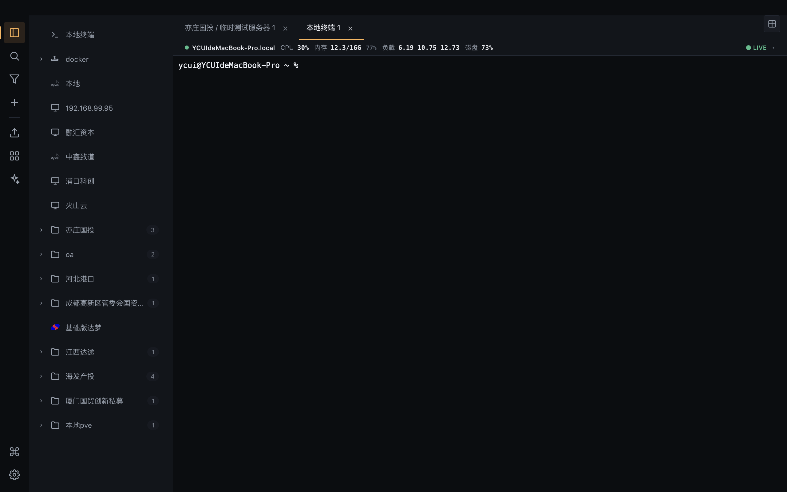 |
| **一个窗口装下运维日常** 终端 / SSH / SFTP / 数据库 / Docker / AI | **终端 · 实时状态条** 打开即采样 CPU / 内存 / 负载 / 全部分区磁盘 |
| 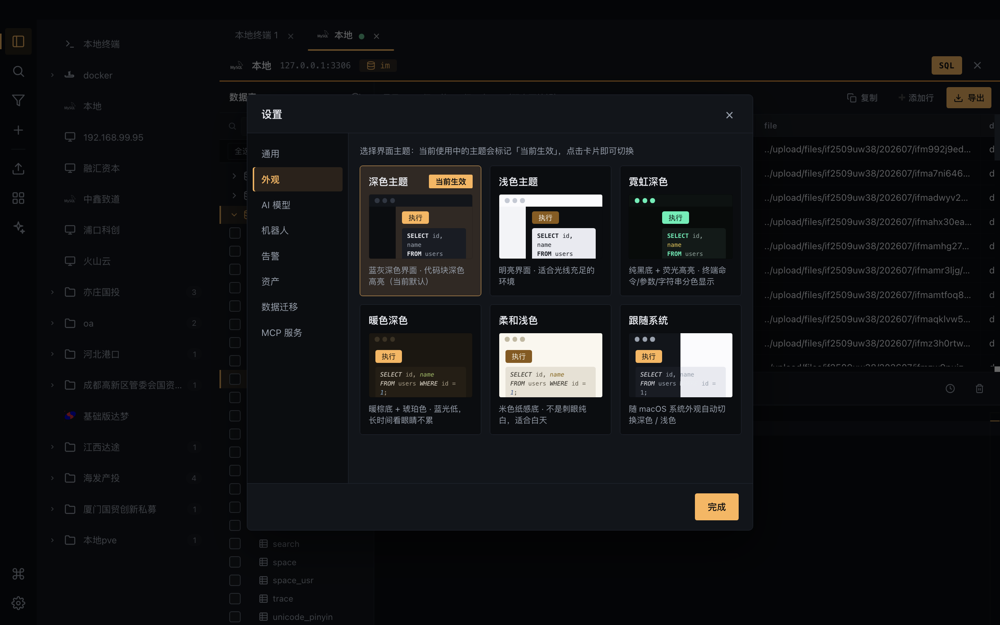 | 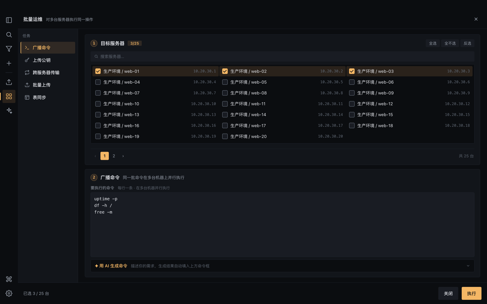 |
| **数据库** 10 种库 · 连上不自动打开库，自己选；支持搜索 | **批量运维** 广播 / 公钥下发 / 跨服直传 / 表同步 |
| 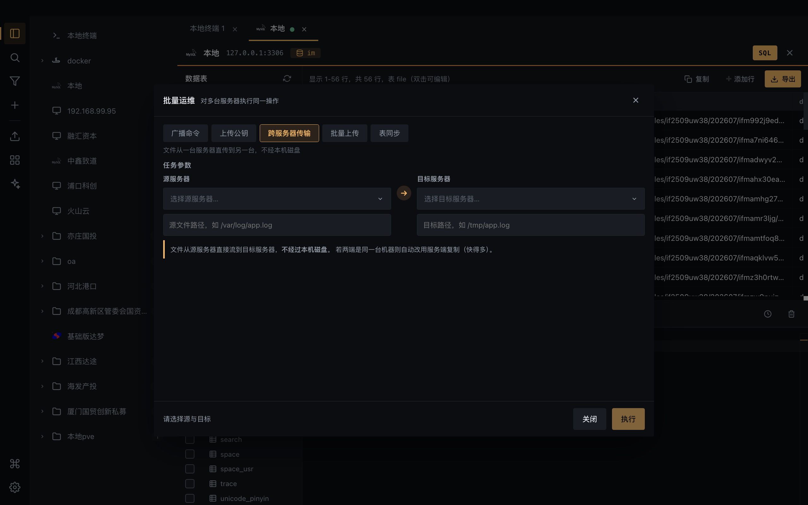 | 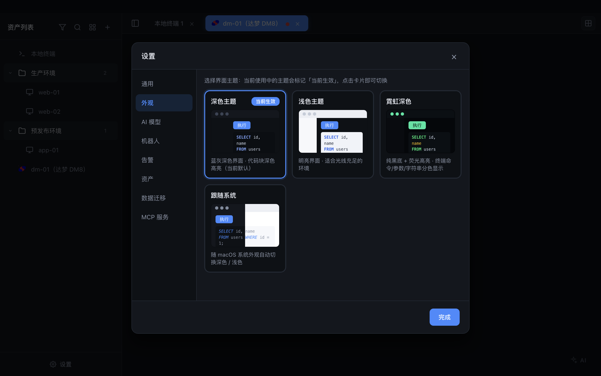 |
| **跨服务器传输** 源左目标右，文件不经本机磁盘 | **五套外观** 深色 / 浅色 / 霓虹 / **暖色深色** / **柔和浅色**，另可整体缩放字号 |

---

## 三个核心能力

### 🤖 AI 运维助手 —— 真的能操作你的服务器

不是"聊天框旁边放个终端"，而是让 AI 自主规划并动手：

- **任务模式**：一句话描述目标（如"找出磁盘占用最大的目录并清理日志"），AI 自主规划步骤、逐条执行、读取输出后决定下一步，直到达成目标或给出结论
- **人在环上**：每条命令执行前都要你批准；危险命令在提示词层就被禁止
- **数据库助手**：连上库后可直接用自然语言查询/改数据，读写分级（只读 SQL 直接执行，写操作需确认）
- **广播接入 AI**：批量运维里同样可让 AI 根据目标生成一批命令，审阅后再打到多台机器
- **IM 接入**：微信（iLink 扫码绑定）/ 钉钉 / 飞书 / 企微 / QQ 里发消息就能查资产、看状态、执行只读命令

### 📊 智能监控与告警 —— 不用盯，出事它先知道

- **实时状态条**：打开终端即每 5 秒采样 CPU / 内存 / 负载 / **全部分区磁盘**，数值跳动直观可见
- **自动巡检**：按间隔巡检所有 SSH 资产，超过阈值自动触发
- **AI 分析**：告警不只是报数，AI 会分析原因并给出处置建议
- **多通道推送**：钉钉机器人 / 邮件（SMTP）/ 阿里云短信
- **大文件排查**：按阈值只扫超标分区，**全程只读**（命中任何删除类命令立即中止）
- **告警归档**：超期记录打包成摘要发到已启用渠道，7 天保留 + 30 天硬清理

### ⚡ 自动化批量运维 —— 一手打到多台机器

- **广播命令**：同一批命令并行打到多台机器，逐机看输出与退出码
- **上传公钥**：ssh-copy-id 等价（自动建 `.ssh`、修权限、去重）
- **跨服务器传输**：文件从 A 直传 B，**不经过本机磁盘**（同机自动退化为服务端复制）
- **批量上传**：拖拽一批文件分发到多台服务器，目标目录可视化浏览选择
- **表数据/结构同步** · **数据库迁移**：同类型库直接搬 DDL；**跨类型（如 MySQL → 达梦）自动做字段类型映射**，无法映射时明确指出是哪一列
- **多机操作台**：分屏最多 **4 格** + **同步输入**（一次键入，四台机器同时执行）

---

## 完整功能

| 模块 | 能力 |
|---|---|
| **终端** | 本地 shell（Windows 用 PowerShell）· 分屏最多 4 格 · 同步输入 · 命令广播 |
| **SSH** | 密码/私钥认证 · 跳板隧道 · 断线自动重连 · 实时状态条 · **通过服务器开 SOCKS5 代理拉起浏览器**（访问内网后台） |
| **SFTP** | 上传/下载/新建目录/删除 · 拖拽上传（**支持整个文件夹**）· 列排序 · 进度与取消 · **跨服务器直传** |
| **数据库** | MySQL / MariaDB / PostgreSQL / 金仓 / Redis / SQLite / SQL Server / Oracle / **达梦** / ClickHouse · 连上不自动展开库（自己选，支持搜索库名与表名） |
| **SQL 编辑器** | Monaco · 全方言自动限行 · 结果分页 · 表格内增删改 · **导入 .sql 文件**（正确切分字符串/注释里的分号与 DELIMITER 存储过程）· 多格式导出 |
| **Docker** | 以标签页打开（可与其他面板并看）· 容器/镜像/卷/网络 · **拉取镜像（带进度）** · **自定义私有仓库** · **Compose 编辑与启停** · 容器内终端与文件管理 · 本地 socket / TCP / SSH 隧道三种连接 |
| **资产源** | 从 **git 仓库或本地文件** 同步资产清单（团队共享配置），支持全部导入格式 |
| **资产导入导出** | CodeShell JSON / CSV / PuTTY .reg / MobaXterm ini / Xshell .xsh / SecureCRT / Tabby |
| **安全基线检查** | **25 项只读检测** · 多机并发扫描（逐机进度）· 按等级分级与筛选 · **AI 分析整改方案** · 导出 PDF / Word / CSV |
| **MCP 服务端** | 设置里一键启动，把资产与只读执行能力以 Model Context Protocol 暴露给外部 agent |
| **外观** | 深色 / 浅色 / **霓虹深色（分色显示）** / **暖色深色（护眼）** / **柔和浅色（纸感）** / 跟随系统 —— **终端配色随主题切换** |

## 快捷键

| 快捷键 | 功能 |
|---|---|
| `⌘ ⇧ F` / `⌘ F` | 全局搜索资产 |
| `⌘ R` | 刷新当前面板 |
| `⌘ E` | 重开最近关闭的标签 |
| `⌘ W` | 关闭当前标签 |
| `⌘ 0` | 显示 / 隐藏资产列表 |
| `⌘ 1` ~ `⌘ 9` | 切换到第 N 个标签 |
| `⌘ Home` | 回到首页 |
| `⌘ /` | 快捷键速查 |
| 终端内右键 | 复制 / 粘贴 / 全选 / 导出日志 / 清屏 / 文件传输 |
| `⌘ Enter` | 执行 SQL（编辑器内） |
| `⇧ ⌥ F` | 格式化 SQL（编辑器内） |

## 下载安装

从 **[Releases](../../releases)** 下载：

- **macOS（Apple Silicon）**：`CodeShell-<version>-arm64.dmg`
- **Windows（x64）**：`CodeShell-<version>-win-x64-setup.exe`（安装版）或 `-portable.exe`（免安装）

> ⚠️ 安装包未购买代码签名证书，首次运行系统会拦一下 —— 这是正常现象，不是文件损坏也不是病毒。
> 详细步骤见 **[安装说明.txt](./安装说明.txt)**。简单说：
> **Windows** 点「更多信息」→「仍要运行」；**macOS** 在「应用程序」里右键 CodeShell → 打开。

## 技术栈

Electron 30 · React 18 · TypeScript · Zustand · xterm.js · Monaco · ssh2 · dockerode ·
node-pty · mysql2 / pg / mssql / oracledb / dmdb / ioredis / better-sqlite3

## 关于本仓库

本仓库是 CodeShell 的**发布与文档页**：这里提供安装包下载、功能说明与更新日志。
**应用源码为闭源**，不在本仓库中。

- 安装包下载：[Releases](../../releases)
- 问题反馈与功能建议：[Issues](../../issues)（欢迎提需求）
- 更新日志：[CHANGELOG.md](./CHANGELOG.md)

## 许可

Copyright © 2026. 保留所有权利（All rights reserved）。

本软件为闭源商业软件，仅授权**个人免费使用**。未经书面许可，不得：
反编译、反汇编、逆向工程，修改、二次分发、转售或用于商业用途。

详见 [LICENSE](./LICENSE)。
